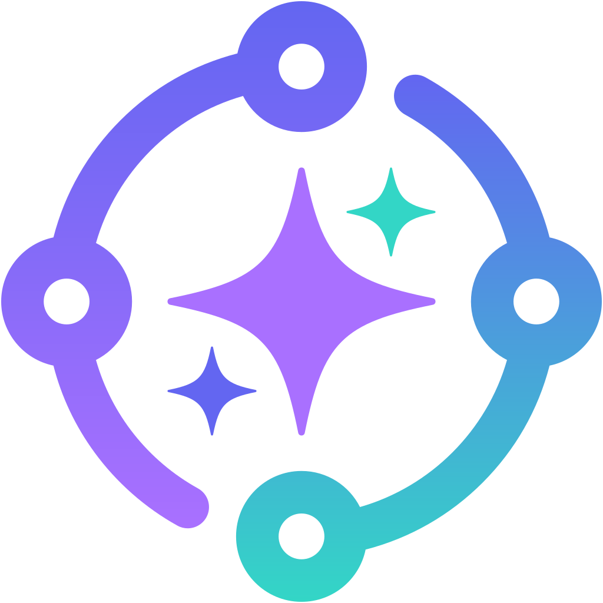
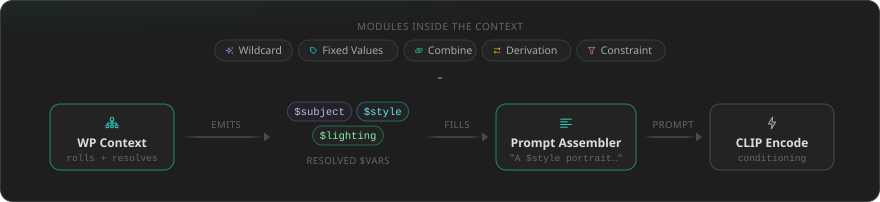
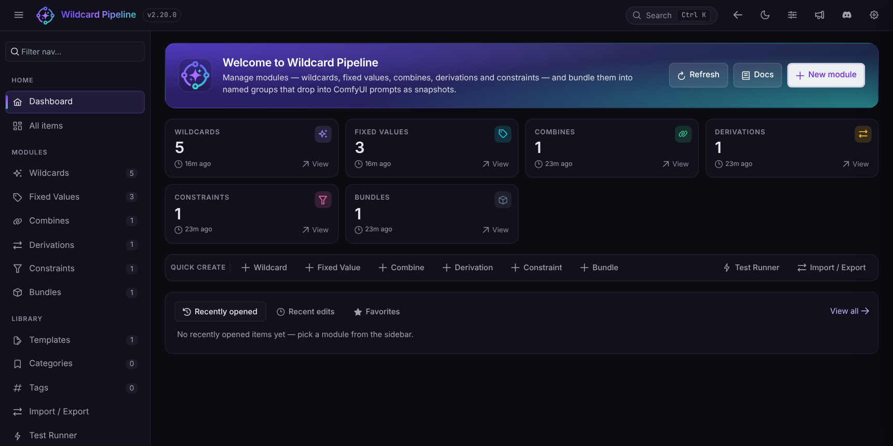

<h1 align="center">
  
  &nbsp;Wildcard Pipeline
</h1>

<p align="center">
  <em>Random prompts for ComfyUI that actually make sense together.</em>
</p>

<p align="center">
  <a href="https://github.com/DumiFlex/ComfyUI-Wildcard-Pipeline/actions"></a>
  <a href="https://github.com/DumiFlex/ComfyUI-Wildcard-Pipeline/releases"></a>
  <a href="https://github.com/DumiFlex/ComfyUI-Wildcard-Pipeline/blob/main/LICENSE"></a>
  <a href="https://github.com/DumiFlex/ComfyUI-Wildcard-Pipeline/wiki"></a>
  <a href="https://discord.gg/BFYR9WQdVR"></a>
  <a href="https://wp.dumiflex.dev/?utm_source=github&amp;utm_medium=readme"></a>
</p>

<p align="center">
  
</p>

Plain wildcards pick every part of a prompt on its own, so you get a snowy beach
at noon under the stars. Wildcard Pipeline builds the prompt step by step, and
each step can see what the earlier ones picked. If the weather comes out as rain,
the mood can lean gloomy and the lighting can follow. Every Generate gives you a
fresh prompt that still hangs together.

## Install

Needs a ComfyUI with the V3 node API and Python 3.10 or newer. The canvas
side is built against ComfyUI frontend 1.42 (the
`@comfyorg/comfyui-frontend-types` version in `package.json`); it uses some
frontend internals, so a much older or newer frontend may break parts of it.

- **ComfyUI Manager (recommended):** search for **Wildcard Pipeline** by
  **dumiflex**, click **Install** and restart ComfyUI.
- **By hand:** download the zip from the
  [latest release](https://github.com/DumiFlex/ComfyUI-Wildcard-Pipeline/releases/latest),
  unzip it into `ComfyUI/custom_nodes/` and restart ComfyUI.

<details>
<summary>Installing from source</summary>

A git clone has no built frontend, so you need Node.js and pnpm:

```bash
cd ComfyUI/custom_nodes
git clone https://github.com/DumiFlex/ComfyUI-Wildcard-Pipeline
cd ComfyUI-Wildcard-Pipeline
pnpm install
pnpm build
```

</details>

## Quick start

1. Open the **Wildcard Pipeline** manager from the ComfyUI sidebar and create a
   wildcard called `subject` with three options: `a cat`, `a dog`, `a fox`.
2. On the canvas, chain **WP Context** → **WP Prompt Assembler** →
   **CLIP Text Encode**. Add your wildcard to the Context node and type
   `a photo of $subject` into the Assembler.
3. Queue a few times. Each run picks a new subject.

The [Quick Start wiki page](https://github.com/DumiFlex/ComfyUI-Wildcard-Pipeline/wiki/Quick-Start)
walks through a fuller example.

## How it works

You stack **modules** inside a **WP Context** node. Each module sets one or more
`$variables`, and the **WP Prompt Assembler** drops them into your template.

| Module | What it does |
|---|---|
| **Wildcard** | Picks one option from a weighted list. |
| **Fixed Values** | Sets variables to values you choose, like a style or quality tags. |
| **Combine** | Builds one variable out of others, e.g. `$style $subject`. |
| **Derivation** | If/else rules: "if `$weather` is rain AND `$time` is night, set `$lighting` to neon". Conditions can be grouped with AND / OR. |
| **Constraint** | Makes an earlier pick change the odds of a later one, or rule options out entirely. |
| **Bundle** | A saved group of modules you can drop in as one piece. |

An option can draw from another wildcard: type `@` in the option and pick it from
the list, and it goes in as a reference chip (`@{…}`). If the module you want
doesn't exist yet, pick **Placeholder** from the `@` list and connect it later.

### Nodes

| Node | What it does |
|---|---|
| **WP Context** | Holds your module stack and outputs the picked variables. Chain several together. |
| **WP Prompt Assembler** | Fills `$variables` in a template and collects their negative words into a second output. |
| **WP Context Loop** + **WP Seed List** | Run the whole chain N times from one Generate, each with its own prompt and seed, or sweep every combination of chosen wildcard options. |
| **WP Context Injector** | Turns any ComfyUI output (text, a number) into a `$variable`. |
| **WP Model Info** | Reads the loaded checkpoint into `$model_family` / `$model_variant` (Pony, Illustrious, …) so rules can pick LoRAs and tags per model. |
| **WP Toggles** | Several on/off switches in one node: each writes a true/false `$variable` for rules and can have a BOOLEAN output. Merges existing Boolean nodes. |
| **WP Image Filter** | Pauses the run so you pick which images go on to the upscaler. Their latent, conditioning, prompt text and Context are filtered with them, and you can edit a prompt or paint a mask before they go on. |
| **WP Label & Grid** | Writes labels on images and lays them out in one labelled grid, or an XY plot sorted by each image's sweep options. Works on one image, a batch, a list or a loop's frames; grid presets follow the shape of the run. |
| **WP Prompt Cleaner** | Tidies the final prompt: spacing, stray commas, empty `()`, nested weights, LoRA tags, duplicates, a blocklist. |
| **WP Debug** | Shows what happened during a run (see below). |
| **WP Var → Int / Float / Bool** | Use a variable to drive a number or switch, like image size or steps. |
| **WP Var → Choice** | Use a variable to pick from a dropdown, like the checkpoint or sampler. Matches it against the real list. |

Most nodes have a help page in ComfyUI's node info panel, and the
[wiki](https://github.com/DumiFlex/ComfyUI-Wildcard-Pipeline/wiki) covers
[nodes](https://github.com/DumiFlex/ComfyUI-Wildcard-Pipeline/wiki/Nodes),
[modules](https://github.com/DumiFlex/ComfyUI-Wildcard-Pipeline/wiki/Modules) and
[concepts](https://github.com/DumiFlex/ComfyUI-Wildcard-Pipeline/wiki/Concepts)
in depth.

## The manager

Open it from the ComfyUI sidebar. It's where your modules live between workflows.

<p align="center">
  
</p>

- **Library:** create, edit and search your modules, bundles and prompt
  templates. The **Tags** page groups them into collections, and you can rename
  or merge a tag across the whole library.
- **Library health:** one page that finds broken references, constraint rules
  for options that are gone, variables nothing sets, duplicates and unused
  items, with a way to fix or ignore each, and checks how varied a bundle's
  prompts are.
- **Test Runner:** try a set of modules over many seeds without generating
  images. See how often each option comes up and which rules fired, save a
  baseline, and after an edit see exactly which outputs changed.
- **Community:** browse and install modules other people have shared on the
  [community site](https://wp.dumiflex.dev/?utm_source=github&utm_medium=readme), and publish your own.
- **Import / Export:** move modules between machines as JSON files, or bring in
  wildcard packs from A1111 or Forge (Dynamic Prompts, PPP, Impact Pack and Umi AI
  `.txt`, `.yaml`, `.json` or a `.zip`, or an installed extension's wildcard folder)
  on the **Wildcard packs** tab. Variables, template arguments and if-conditions
  become stacks. You review the plan and sample prompts before anything is imported.
- **AI assistant (optional, off by default):** connect a model you run yourself
  (Ollama, LM Studio, llama.cpp) or your own Claude or OpenAI key. It drafts and
  edits modules in every editor, answers questions about your library in a chat,
  explains Test Runner runs, organizes your library and builds whole packs from a
  description. Every change comes back for you to review, and nothing is saved
  until you apply it. A short **About my library** note in its settings (your
  naming, style, model, what to never add) is read by every request.
- **Constraint preview:** a table of each target option's chance for every
  source option, so you can see what a constraint does before running it.
- **Themes:** six colour themes (Orbit, Native, Nebula, Tide, Ember, High
  contrast) and seven looks (Orbit, Crisp, Soft, Terminal, Editorial, Compact,
  TUI) in **Settings › Appearance**. Mix any colours with any look, in dark or light.
- **Documentation:** the full guide, built into the app.

## Checking a run

Connect **WP Debug** to a Context node and generate. It shows:

- **Variables:** every value, and which step set it.
- **Trace:** each step, and why it did what it did: which derivation rule fired,
  a wildcard's odds and what re-weighted them, where a nested pick came from.
- **Warnings:** anything that went wrong, linked to the step that caused it.
- **Raw:** the underlying data, for bug reports.

## Help and sharing

[Discord](https://discord.gg/BFYR9WQdVR) is the place for all of it: there are
channels for questions, bug reports, feature requests and showing what you made.
You can also report bugs on [GitHub Issues](https://github.com/DumiFlex/ComfyUI-Wildcard-Pipeline/issues).

Made something you like? Post your images and workflows on Discord, and publish
your modules on the [community site](https://wp.dumiflex.dev/?utm_source=github&utm_medium=readme) so others can
install them from the manager's **Community** page.

## Support

Wildcard Pipeline is free and made by one person. If it helps you, you can
support it on [GitHub Sponsors](https://github.com/sponsors/DumiFlex),
[Buy Me a Coffee](https://buymeacoffee.com/dumiflex) or
[PayPal](https://paypal.me/DumiFlex). The same links are in the manager under
**Settings › About**.

## Privacy

Everything runs locally. The extension only goes online to check for updates
(you can turn this off in Settings), when you open the Community page, or when
you choose to download the optional tag list for autocomplete. The optional AI
assistant is off until you turn it on, and then talks only to the model server
you choose (a local one keeps everything on your PC), plus the search engine,
page reader or Danbooru lookup if you set those up. Details are in
[docs/network-access.md](docs/network-access.md).

## Contributing

PRs are welcome. [CONTRIBUTING.md](.github/CONTRIBUTING.md) explains the dev setup.

## License

Copyright (C) 2026 DumiFlex.

Wildcard Pipeline is free software, released under the [GNU General Public License v3.0 or later](LICENSE).
